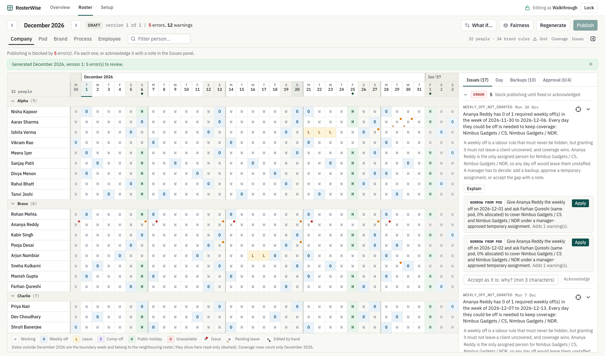
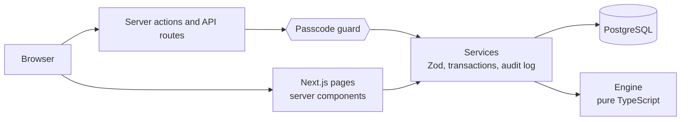

# RosterWise: Smart Roster Management System

[](https://github.com/Gurpreet-pixel-hue/rosterwise/actions/workflows/ci.yml)

**Live demo: https://rosterwise-iota.vercel.app** (anyone can view; changing data needs the shared passcode, given in the submission email).

A browser-based roster planner for a multi-brand customer-operations team. It generates a monthly roster across
brands, processes and pods, validates it against coverage and weekly-off rules, flags every conflict with a plain
explanation and ranked fixes, and handles a leave or rule change as a previewed, versioned edit instead of a rebuild.



> **Context.** Built as the assessment project for the DataStraw AI internship. The company, brands and people in the
> demo data are fictional.

## What it does

- **Master data in the UI.** Employees, pods and pod leads, brands, processes, brand-process rules (operating rule,
  minimum staff, weekday minimums, per-day overrides, shift), PRIMARY and BACKUP assignments with allocation,
  holidays, leaves and comp-offs. A manager changes all of it without touching code.
- **A brand's calendar is not an employee's schedule.** Demand comes from brand-process rules (365 days, no public
  holidays, no Sunday or public holiday, or a custom weekday set). Supply comes from people, their leave and their
  weekly offs. The engine reconciles the two.
- **Generation.** Pick a month, press **Generate**. Same input, same roster, every time.
- **Five views.** Company, Pod, Brand, Process and Employee, with a colour-and-letter grid, a coverage strip
  (`covering / required` per brand-process per day), a "who is working on this date" panel and CSV export.
- **Conflict detection.** Twelve issue codes, separated into hard rules (coverage, weekly off, contract-fixed off,
  shift limits) and preferences. Each issue says who, when and by how much, and carries ranked, pre-validated
  suggestions (`USE_BACKUP`, `SWAP_OFF_DAY`, `REASSIGN_FROM_POD`, `ACCEPT_GAP`).
- **Edit with validation.** A cell edit shows the issue delta _before_ it is saved.
- **Change handling.** "What if..." previews a leave, an unavailability, a rule change or a minimum-staff change, shows
  the cells and issues it would change, and applies it as a new roster version with a diff. Locked cells and past
  dates are kept.
- **Publish gate.** A roster with ERRORs cannot be published unless each one is acknowledged with a written reason.
- **Extras.** Backup recommendations, weekly-off fairness report, version comparison, an optional AI explanation of an
  issue (with a deterministic fallback), and pod-lead approval.

## How it works



- **`src/engine/`** is pure TypeScript: no database, no Next.js, no I/O (an ESLint rule and a test enforce it). It
  expands demand, expands availability, places weekly offs most-constrained-first, fills gaps from backups, then
  validates.
- **One validator.** `validateRoster()` is the single source of truth. Generation, manual edits, change simulation,
  suggestions and the publish check all call it, so there is no second, UI-only check. A test asserts that every
  ERROR the validator finds is one the generator reports.
- **Never silently invalid.** If a rule cannot be met, the engine emits an issue that explains it rather than
  producing a plausible-looking roster. Client coverage beats a preferred day off, but a missing weekly off is still a
  labour violation and is always surfaced.
- **Dates are `YYYY-MM-DD` strings** end to end, so there are no timezone bugs.
- **`src/server/`** holds the services (all rules, tested against a real Postgres) and thin server actions.

Measured numbers (test count, generation time, scaling, coverage with and without backups) are in
[`docs/METRICS.md`](docs/METRICS.md), produced by `pnpm metrics`.

## Run it locally

Needs Node 20+, pnpm and a PostgreSQL database.

```bash
pnpm install
cp .env.example .env          # set DATABASE_URL, DEMO_PASSCODE and SESSION_SECRET
pnpm db:push                  # create the tables
pnpm db:seed                  # 32 employees, 4 pods, 20 brands, December 2026 and January 2027
pnpm dev                      # http://localhost:3000
```

`SESSION_SECRET` is any 32+ character string (`openssl rand -base64 48`). Without both `DEMO_PASSCODE` and
`SESSION_SECRET` the app is view-only: it fails closed and refuses every write.

### Environment variables

| Variable               | Required  | Purpose                                                                                         |
| ---------------------- | --------- | ----------------------------------------------------------------------------------------------- |
| `DATABASE_URL`         | yes       | PostgreSQL connection string                                                                    |
| `DEMO_PASSCODE`        | for edits | Shared passcode typed on `/unlock`                                                              |
| `SESSION_SECRET`       | for edits | 32+ characters, signs the session cookie                                                        |
| `ANTHROPIC_API_KEY`    | no        | Enables AI wording on "Explain this issue". Without it the deterministic explanation is used    |
| `REQUIRE_POD_APPROVAL` | no        | Set to `true` to make publishing require every pod lead's approval (off by default)             |
| `TEST_DATABASE_URL`    | no        | A separate database whose name contains `test`, for the integration tests. They skip without it |

### Scripts

| Script                         | What it does                                                                 |
| ------------------------------ | ---------------------------------------------------------------------------- |
| `pnpm dev` / `build` / `start` | Run, build and serve the app                                                 |
| `pnpm test`                    | Engine scenario tests, service integration tests, UI logic tests             |
| `pnpm lint` / `typecheck`      | ESLint, `tsc --noEmit`                                                       |
| `pnpm db:push` / `db:seed`     | Create tables / load the demo data (it resets the database)                  |
| `pnpm db:reset-demo`           | Reset to the demo data (also clears any unlock lockout)                      |
| `pnpm verify:seed`             | Check the seed against the assessment's requirements and print the scenarios |
| `pnpm roster:dry-run 2026-12`  | Generate a month with the real engine and print a text grid, nothing saved   |
| `pnpm metrics`                 | Measure everything in `docs/METRICS.md`                                      |
| `pnpm walkthrough:p4`          | Drive the running app in a real browser through every demo scenario          |

## Security and access

Public read, shared-secret write, no per-user accounts. Every mutating server action goes through one guard, and a
test fails if any non-public action stops refusing an unauthenticated call. The session is an HMAC-signed
`httpOnly` cookie (12 hours); the audit actor is taken from the session on the server, never from the browser; wrong
passcodes are limited to 5 per 15 minutes per client in Postgres, race-free; security headers (CSP, frame, referrer,
HSTS) are set everywhere. What this does _not_ do: the display name is self-declared, all data is readable without
login, and the CSP keeps `'unsafe-inline'` for scripts. These are written down with their reasons in
[`docs/ASSUMPTIONS.md`](docs/ASSUMPTIONS.md) (63 to 72).

## Documentation

- [`docs/APPROACH.md`](docs/APPROACH.md): the approach in one page
- [`docs/DEMO_SCRIPT.md`](docs/DEMO_SCRIPT.md): a timed 4 to 5 minute walkthrough and the seeded demo scenarios
- [`docs/ASSUMPTIONS.md`](docs/ASSUMPTIONS.md): every assumption, written down as it was made
- [`docs/METRICS.md`](docs/METRICS.md): measured numbers, generated by `pnpm metrics`
- [`docs/PROGRESS.md`](docs/PROGRESS.md) and `docs/reviews/`: the phase-by-phase build and review record

## Stack

Next.js 15 (App Router) · TypeScript (strict) · Prisma 6 · PostgreSQL (Neon) · Tailwind CSS · shadcn/ui · Zod ·
Vitest · Playwright (walkthrough) · Vercel
